<p align="center">
  <picture>
    <source media="(prefers-color-scheme: light)" srcset="assets/banner-light.svg">
    
  </picture>
</p>

## About Me

I'm a full-stack web developer who enjoys crafting **clean, intuitive, and meaningful digital experiences**. With a background in **graphic design** and **data operations**, I approach projects with a balance of creativity, structure, clarity, and precision — building software that feels human-centered and thoughtfully engineered.

<p align="center">
  <picture>
    <source media="(prefers-color-scheme: light)" srcset="assets/divider-light.svg">
    
  </picture>
</p>

## Education

I completed my undergraduate degree in **China**, an international environment that expanded my technical perspective and strengthened my ability to collaborate across cultures, disciplines, and languages.

<p align="center">
  <picture>
    <source media="(prefers-color-scheme: light)" srcset="assets/divider-light.svg">
    
  </picture>
</p>

## Developer DNA

- Full-Stack Thinker
- Design-Conscious Coder
- Accuracy-Driven Data Professional
- Multilingual Communicator
- Problem Solver with Creative Insight
- Values Clean UI, Clean Code, Clean Architecture

<p align="center">
  <picture>
    <source media="(prefers-color-scheme: light)" srcset="assets/divider-light.svg">
    
  </picture>
</p>

## Tech Stack

<p align="center">
  <picture>
    <source media="(prefers-color-scheme: light)" srcset="assets/stack-light.svg">
    
  </picture>
</p>

<p align="center">
  <picture>
    <source media="(prefers-color-scheme: light)" srcset="assets/divider-light.svg">
    
  </picture>
</p>

## Code That Describes Me

```ts
const profile = {
  role: "Full-Stack Developer",
  stack: ["Next.js", "React", "NestJS", "Tailwind", "TypeScript"],
  strengths: ["Clean UI", "Smooth UX", "Maintainable Code"],
  languages: ["English", "Chinese", "Sinhalese"],
  approach: "Build with clarity. Design with intention.",
};
```

### Architecture I Typically Build

```text
Frontend   Next.js + React + Tailwind
Backend    NestJS / Node.js + Express
Database   PostgreSQL + Prisma, or MongoDB
Design     Figma + component systems
DevOps     Git + Vercel + Linux

        [ Next.js UI ]
              ↓
        [ API Routes ]
              ↓
   [ NestJS / Node.js Logic ]
              ↓
[ Database Layer (SQL / NoSQL) ]
```

<p align="center">
  <picture>
    <source media="(prefers-color-scheme: light)" srcset="assets/divider-light.svg">
    
  </picture>
</p>

## Currently Exploring

- Deepening my full-stack flow with Next.js Server Actions
- Building my own TypeScript utility library
- Exploring UI animation practices with Motion
- Expanding my skills in design systems and component architecture

<p align="center">
  <picture>
    <source media="(prefers-color-scheme: light)" srcset="assets/divider-light.svg">
    
  </picture>
</p>

## Activity

<p align="center">
  <picture>
    <source media="(prefers-color-scheme: light)" srcset="assets/stats-light.svg">
    
  </picture>
</p>

<p align="center">
  <picture>
    <source media="(prefers-color-scheme: light)" srcset="assets/langs-light.svg">
    
  </picture>
</p>

<p align="center">
  <picture>
    <source media="(prefers-color-scheme: light)" srcset="assets/contrib-light.svg">
    
  </picture>
</p>

<p align="center"><sub>Drawn from the GitHub API and refreshed daily by a workflow in this repository.</sub></p>

<p align="center">
  <picture>
    <source media="(prefers-color-scheme: light)" srcset="assets/divider-light.svg">
    
  </picture>
</p>

## Connect

<p align="center">
  <a href="https://www.pasindev.ninja"><picture><source media="(prefers-color-scheme: light)" srcset="assets/link-portfolio-light.svg"></picture></a>
  <a href="https://linkedin.com/in/pasindeveloper"><picture><source media="(prefers-color-scheme: light)" srcset="assets/link-linkedin-light.svg"></picture></a>
</p>
